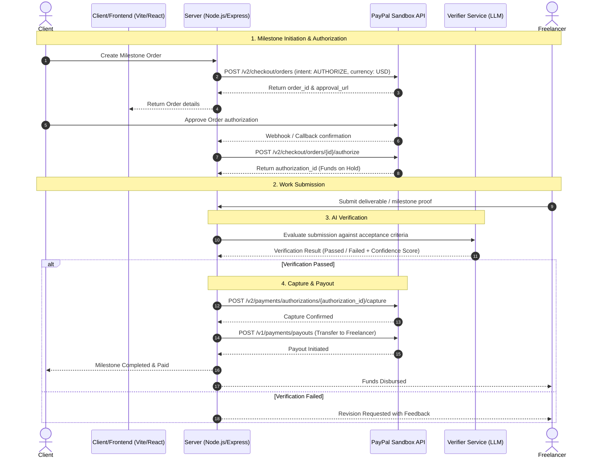

# MilestonePay Agent Architecture

## Overview
MilestonePay Agent facilitates trustless milestone-based payments between clients and service providers/freelancers. It integrates PayPal's Authorization & Capture APIs with an AI-driven verification pipeline to validate completion before releasing funds.

## Core Milestone Lifecycle & Flow

## Step-by-Step Flow Description
1. **Per-Milestone PayPal Order (`intent: AUTHORIZE`)**:
   - For every distinct project milestone, an individual PayPal order is created with `intent: AUTHORIZE` specifying the milestone amount in USD.
2. **Client Approval & Hold**:
   - The client approves the payment on PayPal. The backend performs the authorization call (`/v2/checkout/orders/{id}/authorize`) to place an authorized hold on the client's funds without capturing immediately.
3. **AI Verifies the Submission**:
   - The freelancer submits evidence, links, files, or deliverables.
   - The Verifier Service evaluates the output against explicit milestone specifications using an LLM.
4. **Capture**:
   - Upon successful AI verification (and client confirmation if configured), the backend captures the authorized payment (`/v2/payments/authorizations/{authorization_id}/capture`).
5. **Payout**:
   - Funds are disbursed to the freelancer via the PayPal Payouts API.

## Directory Layout
- `client/`: React frontend (Vite)
  - `src/pages/`: Screen views
  - `src/components/`: Reusable UI modules
  - `src/api/`: API integration layer
- `server/`: Express backend
  - `src/routes/`: Express endpoint routes
  - `src/services/paypal/`: PayPal client, auth, orders, authorizations, and payouts
  - `src/services/verifier/`: LLM verification agent logic
  - `src/db/`: SQLite schema, migrations, and query interfaces
  - `src/webhooks/`: PayPal webhook listeners
  - `tests/`: Automated unit and integration tests
- `scripts/`: Operational and database helper scripts

